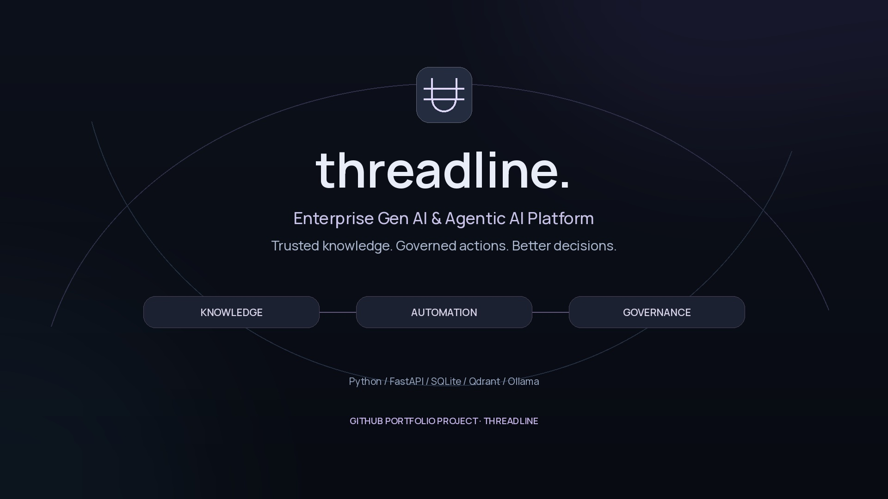
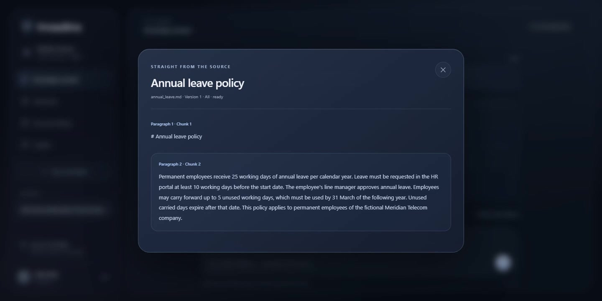
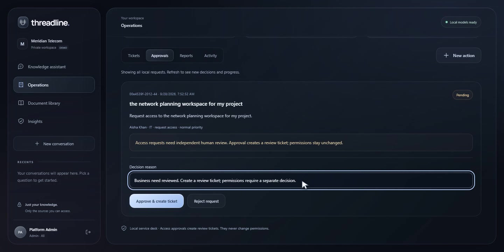
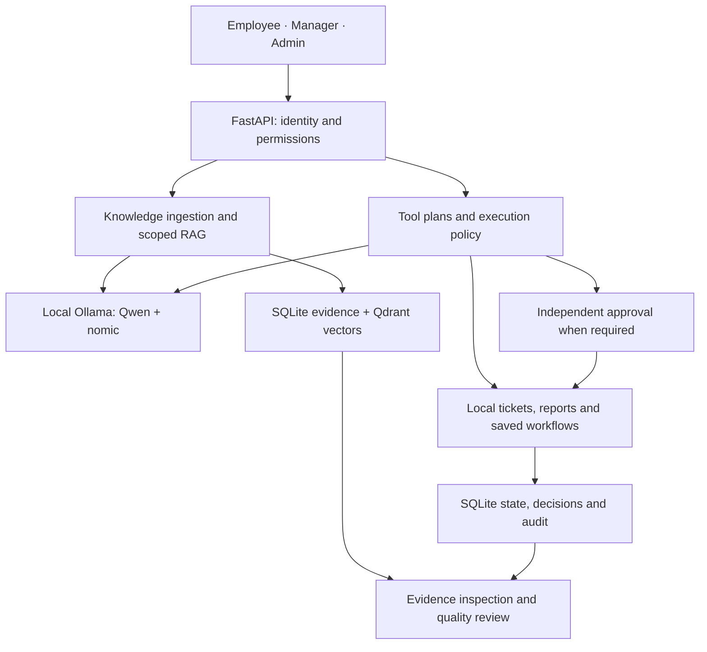

# Threadline

### Enterprise GenAI & Agentic AI Platform

**Trusted knowledge. Governed actions. Better decisions.**

Threadline connects enterprise knowledge retrieval with controlled operational workflows. Employees get evidence-backed policy answers and trackable requests; managers create cited briefings and review departmental work; administrators govern documents, approvals, and platform quality. Generation and embeddings run locally through Ollama.

**Portfolio prototype · Python 3.12 · Local Qwen · SQLite + Qdrant · MIT license**

[](https://github.com/MohamedZakkaria2004/Threadline/actions/workflows/verify.yml)

## See it working

[](https://github.com/MohamedZakkaria2004/Threadline/releases/download/v0.3.1/Threadline-Enterprise-Demo.mp4)

**[Watch / download the 2:50 demo](https://github.com/MohamedZakkaria2004/Threadline/releases/download/v0.3.1/Threadline-Enterprise-Demo.mp4)** · [Release and video](https://github.com/MohamedZakkaria2004/Threadline/releases/tag/v0.3.1) · [Captions](docs/media/Threadline-Enterprise-Demo.srt) · [Screenshots](docs/PROTOTYPE.md)

Actual application footage: Admin → Manager → Employee → independent approval → tracked ticket. Clear narration, matching captions, no music. Model waits are shortened and labeled; the video is not a real-time latency demonstration.

**Review in five minutes:** [Business value](#the-business-problem) → [Architecture](#system-architecture) → [Roles](#role-based-workflows) → [Governance](#governance-and-responsible-ai) → [Evaluation](#evaluation-and-evidence) → [Run locally](#run-locally).

> A working, single-machine enterprise AI prototype for a fictional telecom organization. It demonstrates enterprise control patterns; it is not a production service or connected ITSM product. Access approval creates a local review ticket and never grants system permissions.

## The business problem

Internal knowledge is scattered across policy documents, while questions and operational requests move through disconnected channels. An enterprise assistant must make its evidence inspectable, respect the requester's permissions, and turn explicit intent into accountable work.

| Enterprise need | Implemented capability | Business relevance |
|---|---|---|
| Trustworthy guidance | Permission-scoped RAG with original passages and page/paragraph references | Verify answers before relying on them |
| Operational follow-through | Local tickets, cited reports, persistent action traces | Inspect real artifacts instead of generated promises |
| Control sensitive work | Independent approval, exact request binding, idempotent writes | Keep human authority separate from model planning |
| Decision support | Restricted leadership knowledge, briefings, SQL-backed ticket counts | Support decisions within authorized scope |
| Measurable oversight | Evaluations, usage/latency metrics, prompt fingerprints, ROI scenarios | Inspect quality and challenge value assumptions |

The [enterprise case](docs/ENTERPRISE_CASE.md) covers stakeholders, build versus buy, illustrative implementation cost, ROI, adoption KPIs, and rollout. Financial scenarios are planning estimates, not measured savings.

## Role-based workflows

| Role | Typical journey | Permission boundary |
|---|---|---|
| **Employee** | Ask a policy question → inspect evidence → submit a request → follow saved progress | Company-wide internal and own-department internal documents; own conversations, reports, and tickets |
| **Manager** | Consult leadership guidance → generate a briefing → review departmental work | Adds leadership sources within permitted scope and eligible departmental tickets/approvals; no document administration |
| **Admin** | Upload/version documents → set audience → review requests → inspect quality and platform activity | All documents and tickets; no self-approval or reading another user's private conversation/report |

All roles can ask questions, request supported actions, generate their own reports, view personal insights, and explore business scenarios. `hr` is a second Employee account in HR, not a fourth role. [Complete RBAC matrix](docs/ROLES_AND_PERMISSIONS.md).

### One complete governed workflow

1. Employee asks about annual leave and verifies **25 working days** in the fictional source policy.
2. In **Actions**, they request workspace access. Qwen selects `request_access`; server policy pauses execution.
3. A different authorized reviewer inspects the exact request and records an approval or rejection with a reason.
4. Approval creates one **access-review ticket**, updates saved workflow/conversation state, and records the decision. Permissions remain unchanged.
5. Employee reopens the conversation and tracks ticket progress. Repeated requests or decisions cannot create duplicate artifacts.

## Working prototype

| Source-grounded knowledge | Human control over sensitive actions |
|---|---|
|  |  |
| Inspect the exact passage and document version. | Review the submitted request before creating a local review ticket. |

[Full screenshot gallery](docs/PROTOTYPE.md): ingestion, manager briefings, Quality lab, monitoring, and the dark glass interface. Screenshots use fictional personas and public/synthetic documents.

## System architecture



This component map shows the knowledge and action paths; sensitive actions follow the approval branch before execution. SQLite is the authority for source text, access rules, and business state. Qdrant supplies similarity candidates; model output never authorizes a write. [Detailed architecture, trust boundaries and recovery](docs/ARCHITECTURE.md).

## RAG and agentic functionality

**Knowledge:** documents → bounded extraction → overlapping chunks with provenance → local embeddings → indexing → permission-filtered retrieval → canonical SQL evidence → structured Qwen response → quote/number checks → cited answer or abstention.

**Actions:** explicit request → Qwen tool selection → schema and intent checks → deterministic risk policy → approval when required → transactional execution → saved artifact, state, and audit.

| Capability | Implemented behavior |
|---|---|
| Document pipeline | PDF, DOCX, TXT, MD; duplicate detection; status; explicit replacement; failed replacement preserves the old version |
| Retrieval | Role/department filters, vector + lexical ranking, bounded neighboring context, canonical SQL rechecks |
| Citations | Retrieved source IDs, exact normalized quotes, page/paragraph locators, inspectable originals |
| Hallucination handling | Insufficient-evidence responses, fabricated-citation rejection, unsupported-number checks, narrow numeric-conflict refusal, one bounded correction |
| Agent tools | `create_ticket`, `generate_report`, `request_access`; one supported action per request |
| State | Saved conversations, pending approvals, ticket lifecycle, replay protection, visible interruption recovery |
| Reporting | Owner-private cited Markdown briefings, export permission checks, SQL counts of the owner's tickets |
| Oversight | Usage/latency metrics, feedback, redacted audit view, prompt versions, source/model fingerprints, quality review |

The agent is a **bounded tool-planning workflow**. It does not autonomously chain arbitrary tasks, run shell commands or arbitrary SQL, send email, make payments, or grant permissions. [RAG, ingestion, agents and failure behavior](docs/RAG_AND_AGENTS.md).

## Governance and responsible AI

- **Access:** salted PBKDF2 passwords, expiring server-side sessions, login throttling, same-origin protection, server-side role/department and ownership checks.
- **Evidence integrity:** permissions checked before retrieval and again before answer publication; citations resolve to canonical stored text.
- **Human authority:** independent review for sensitive requests; business writes, state transitions, and audit events commit together.
- **Local data path:** loopback Ollama and local UI assets. Initial dependency/model downloads require internet.
- **Honest quality claims:** quote/numeric checks reduce specific errors; they do not prove semantic truth or universal injection resistance. Automated semantic judgments are separate from human review.
- **Deployment boundary:** loopback on a trusted machine with public/fictional documents. Runtime files are plaintext; demo identity is not enterprise SSO.

[Security and governance](docs/SECURITY_AND_GOVERNANCE.md) · [Security reporting](SECURITY.md) · [Operations runbook](docs/OPERATIONS_RUNBOOK.md).

## Evaluation and evidence

Checks compare output with original evidence and persisted business state, not simply HTTP success. [Evaluation methodology](docs/EVALUATION.md) separates deterministic regression, actual-model runs, automated scoring, and source review.

| Historical evidence | Recorded result | Interpretation |
|---|---|---|
| Public/synthetic gold corpus | **21/21 accepted**: 16 RAG + 5 agent cases | Full run plus documented focused rerun; AI-assisted source review |
| Expected evidence retrieved | **11/11 answerable cases** | Case-level evidence-hit rate, not a general retrieval benchmark |
| Factual answers / negative behavior | **11/11 answered correctly; 5/5 correct negative behavior** | Small fixed corpus; not an enterprise accuracy estimate |
| Citation traceability | **12/12 citations** match original evidence | Traceability alone does not establish entailment |
| Local CPU RAG latency | **P50 65.96 s / P95 142.88 s** | Host-specific, historical; not an SLA |
| Independent policy-owner signoff | **Not obtained** | AI-assisted engineering review is not human approval |

Validation uses original [NIST SP 1300](https://nvlpubs.nist.gov/nistpubs/SpecialPublications/NIST.SP.1300.pdf) and the [NIST phishing fact sheet](https://www.nist.gov/document/sbccphishingpdf), plus controlled synthetic threshold, conflict, injection, and restricted-access fixtures. [Gold cases](evaluation/audit/gold.json) specify expected answers, sources, citations, content, tool actions, and failure behavior. [Source provenance and hashes](evaluation/audit/sources.json) are retained.

[Verification evidence](docs/evidence/README.md) records fresh publication checks separately from historical audits. CI covers model-independent checks; it does not imply an Ollama benchmark or production certification.

## Run locally

**Validated:** Windows, Python **3.12**, PowerShell, Git, [Ollama](https://ollama.com/download/windows). Tested on a 16 GB CPU laptop; latency depends on available memory and load. Linux/macOS launch is not validated for this release.

```powershell
git clone https://github.com/MohamedZakkaria2004/Threadline.git
cd Threadline
.\setup.ps1

# One-time downloads; skip already-installed models. Keep Ollama running.
ollama pull qwen3:4b-instruct-2507-q4_K_M
ollama pull nomic-embed-text:latest

# First run: index the fictional policies, then start.
.\start.ps1 -Seed
```

Open **http://127.0.0.1:8765**. Read `demo-credentials.txt` at the exact path printed by the server, normally under `%LOCALAPPDATA%\EnterpriseCopilot`. Fresh installs generate separate random passwords for `employee`, `hr`, `manager`, and `admin`. No shared password is distributed.

Later, use `.\start.ps1` or **Start Threadline.cmd**. Stop the server before reseeding or offline backup: one process owns the vector store. [Setup, configuration and troubleshooting](docs/SETUP.md) · [Role-by-role usage](docs/USAGE.md).

```powershell
.\.venv\Scripts\python.exe -m scripts.repository_check
.\.venv\Scripts\python.exe -m pytest -q
node --test tests/ui_state.test.mjs

# Optional: real local models, isolated store, longer runtime.
.\.venv\Scripts\python.exe -m scripts.e2e_audit --output public-corpus-new-run.json
```

## Tech stack and repository map

| Layer | Technology | Purpose |
|---|---|---|
| Application | Python 3.12, FastAPI, Uvicorn, Pydantic | Local API, validation, authorization, workflows |
| Models | Ollama, Qwen3 4B Instruct, nomic-embed-text | Local generation, tool planning, embeddings |
| State | SQLite | Canonical text, accounts, conversations, artifacts, audit |
| Retrieval | Persistent embedded Qdrant | Vector index without another database service |
| Parsing | pypdf; standard-library DOCX/XML and text parsing | Text extraction with source locations |
| Interface | HTML, CSS, JavaScript, local Manrope | Responsive dark glass UI, no frontend build step |
| Verification | pytest, Node test runner, gold runner, GitHub Actions | Regressions and separately reproducible model evaluation |

```text
app/                  API, RAG, tools, persistence, insights, evaluation, UI
prompts/              Versioned generation/planning/correction/quality prompts
sample_docs/          13 fictional enterprise policies
evaluation/audit/     NIST PDFs, provenance, synthetic fixtures, gold cases
tests/                Python regressions and JavaScript UI-state tests
scripts/              Seed, evaluate, backup/recover, check publication
docs/                 Architecture, roles, setup, enterprise case, audits, media
.github/workflows/    Model-independent verification on Windows
artifacts/README.md   Guide to ignored local outputs
setup.ps1             Pinned dependency setup
start.ps1             Seed/start/test entry point
uv.lock               Locked dependency resolution
requirements.lock.txt Tested Windows pip fallback
```

Runtime databases, vectors, credentials, logs, backups, raw exports, and model weights are excluded. The video is a release asset to keep source checkout small.

## Design choices, limitations, and next steps

Local inference makes the model/data path inspectable. SQLite and embedded Qdrant keep setup manageable; deterministic checks around a small tool registry keep authority outside model output. [Design decisions and trade-offs](docs/DESIGN_DECISIONS.md).

Current boundaries: serial inference, hardware-sensitive latency, English text extraction, no OCR, no external ITSM/SSO connectors, no response streaming, manual operational refresh, and incomplete semantic contradiction detection. An earlier unexplained host interruption is documented. Downloads cannot be recalled. Suitable for a **supervised portfolio demonstration**, not public hosting or unattended enterprise operation.

Future work includes enterprise identity, protected storage and supervised deployment, a broader independently reviewed gold set, capacity testing, background ingestion, and explicitly authorized connectors with end-to-end idempotency. [Limitations and roadmap](docs/ROADMAP.md).

## Documentation and license

[Documentation index](docs/README.md) · [Contributing](CONTRIBUTING.md) · [Security](SECURITY.md) · [Changelog](CHANGELOG.md)

Original code and documentation use the [MIT License](LICENSE). Fonts, public validation documents, dependencies, and separately installed model weights retain their own terms: [third-party notices](THIRD_PARTY_NOTICES.md). No NIST or employer endorsement is implied. Historical records retain the former Atlas name where it identifies the audited version.
