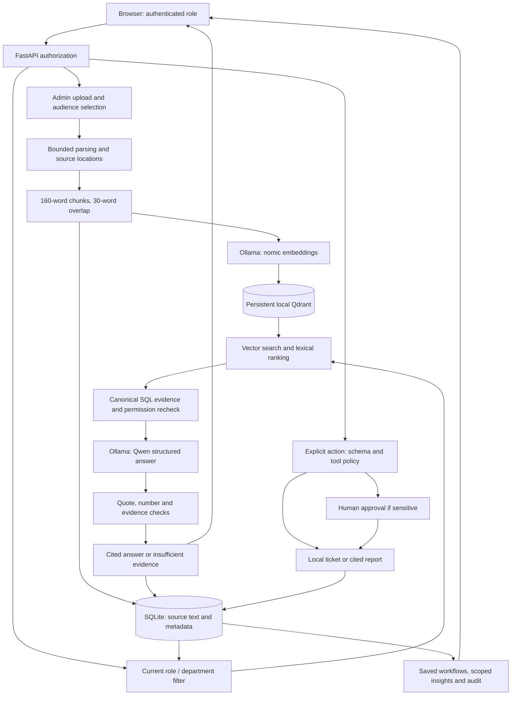
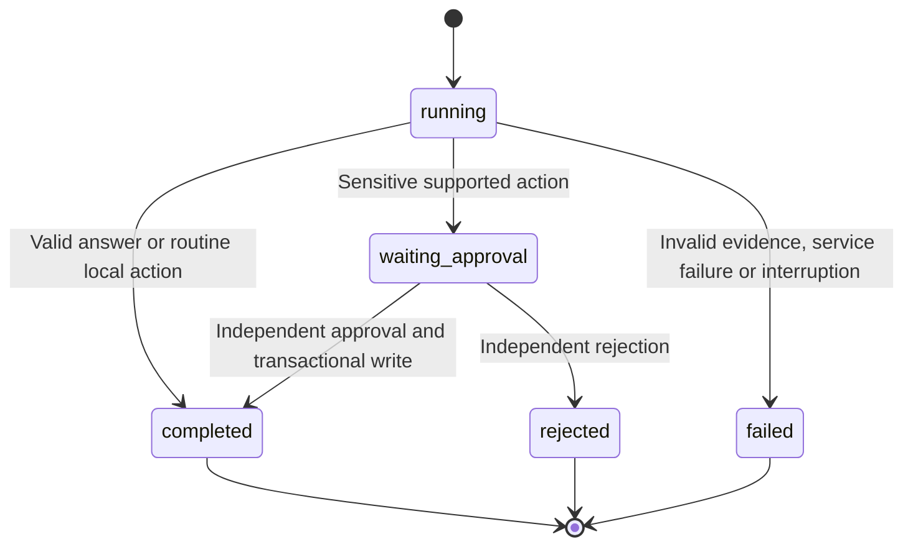

# System architecture

Threadline runs as one FastAPI process on a trusted workstation, with an embedded vector store and a separate local Ollama service. There is no paid inference API, external ticket connector, frontend build server, or distributed job system.

## Components and responsibility

| Component | Responsibility | Authority / boundary |
|---|---|---|
| Browser workspace | Knowledge, actions, sources, operations, insights and governance panels | UI visibility is convenience; API enforces permission |
| FastAPI | Sessions, request validation, authorization, same-origin checks and work serialization | Reloads identity from SQLite; loopback binding |
| Knowledge service | Extraction, chunking, ingestion status, retrieval and evidence validation | Source permissions and canonical SQL text are authoritative |
| Ollama | nomic embeddings and Qwen structured generation/planning | Generates candidates; never authorizes writes |
| Embedded Qdrant | Persistent vector similarity search | Candidate point IDs must reconcile with allowed SQL records |
| SQLite | Users, sources, conversations, workflows, artifacts, decisions, metrics and audit | Transactional business state and source-of-truth metadata |
| Operations service | Intent/tool matching, risk checks, approvals and execution | Fixed tool registry; exactly one local action per request |
| Quality / Insights | Benchmarks, semantic assessment, human review, operational measurement | Automated results and human judgments remain separate |

## Request and data flow

Reports reuse the same permission-scoped RAG path. Their ticket counts come from SQL, not Qwen. Evaluations reuse the model/retrieval path with explicit fixture restrictions and recorded fingerprints; they do not generate operational tickets or conversations.

## Trust boundaries

1. **Browser → API:** sessions, host/origin checks, input limits, and role/ownership authorization. Hidden navigation alone is not a control.
2. **Vector store → evidence:** Qdrant payload text is not final authority. Reload canonical chunks and reconcile point IDs with the allowed SQL document set.
3. **Evidence → model:** documents and history are untrusted data. Context is bounded and scoped before generation.
4. **Model → application:** Pydantic validates structured output; citation/number checks and deterministic intent/risk rules constrain publication and execution.
5. **Reviewer → side effect:** recheck independent reviewer eligibility, request digest, state and current department within the decision transaction.
6. **Application → filesystem:** files remain on the machine but are plaintext. Local administrator access is outside application RBAC protection.

## Consistency and recovery

**Ingestion is staged, not a distributed transaction.** Vectors are written before SQL publishes a document as ready. Failed/partial/superseded records are excluded from new retrieval. A failed replacement keeps the old ready version. A crash can leave unreachable vectors; scalable reconciliation/cleanup is future work.

**Operational writes are transactional.** Ticket/report creation, workflow result, saved message, and audit updates are paired. Approval uses an immediate SQL transaction and a unique ticket/workflow relationship. Request replay is bound to the user, original text, mode, and conversation. Stale ticket updates are rejected.

**Restart does not replay business actions.** Acquire the exclusive vector-store lock first, mark interrupted running work failed, preserve waiting approvals, and show a visible conversation failure. Interrupted evaluations retain partial results. Offline backup/restore verifies hashes and SQL integrity and invalidates restored sessions.

**Model work is serialized.** One inference/indexing/evaluation task holds a process lock; concurrent model work returns a clear busy response. Ordinary reads and approval decisions remain available. Ollama errors become explicit service failures; there is no silent hosted-model fallback.

## State model

Knowledge abstention is a valid completed response with insufficient-evidence metadata, not a fabricated answer. Workflow completion does not imply an external business action occurred: inspect the returned artifact and tool contract.

## Where to read the code

| Concern | File |
|---|---|
| API, sessions, middleware and UI serving | [main.py](../app/main.py) |
| Parsing, vector/SQL reconciliation, retrieval and validation | [knowledge.py](../app/knowledge.py) |
| Knowledge conversations and publication | [chat.py](../app/chat.py) |
| Tools, approvals, reports and ticket updates | [service.py](../app/service.py) |
| Schema, migration, persistence and recovery | [storage.py](../app/storage.py) |
| Local model adapter and metrics | [llm.py](../app/llm.py) |
| Benchmarks / scoped metrics / ROI arithmetic | [evaluation.py](../app/evaluation.py), [insights.py](../app/insights.py), [business.py](../app/business.py) |

See [engineering details](ENGINEERING_DETAILS.md) for implementation-level checks, [RAG and agents](RAG_AND_AGENTS.md), and [design decisions](DESIGN_DECISIONS.md) for trade-offs.
