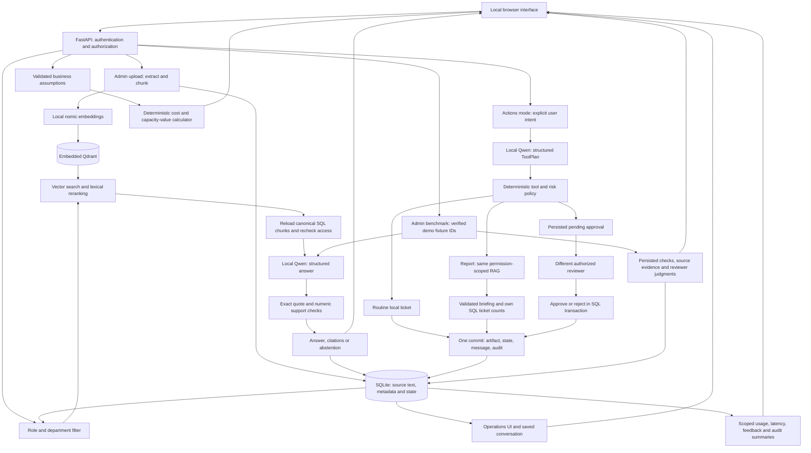

# Detailed engineering behavior

The public-corpus audit adds publication-time upload authorization, canonical SQL/vector point reconciliation before retrieval, and atomic repair by re-uploading an affected file. Retrieval keeps four ranked hits and adds at most two neighbors from the same page or paragraph as the top hits, without dropping competing documents. All neighbors retain canonical SQL metadata and access scope. Prompt `v4` adds explicit conflict handling and one bounded correction for invalid citations as well as unsupported numbers. A narrow deterministic guard refuses otherwise identical relevant numerical rules with different values across active documents; this is not a general semantic contradiction detector. Quote and number validation still does not prove arbitrary factual entailment. See [end-to-end audit](E2E_AUDIT.md).

## Data and trust boundaries

All network activity used for application inference is sent to loopback Ollama. The UI uses same-origin requests and no third-party script or font. Actual policy content is supplied to the model only after filtering by the current authenticated account. SQL source text is authoritative; vector payload text is not trusted as final evidence.

The SQL database and Qdrant are separate stores. Ingestion stages vectors before publishing a document as ready in a SQL transaction. Failed/partial/superseded documents are excluded by their SQL status. Old versions remain for historical citation inspection, but new retrieval selects only the current ready version. Failed replacement leaves the previous version ready. A crash between stores can leave unreachable vectors; this does not publish partial text, and a maintenance cleanup can be added for a larger pilot.

## Authentication and permissions

Session tokens are random; only SHA-256 token hashes are stored in SQL. Passwords use unique salts and PBKDF2-HMAC-SHA256 with 260,000 iterations. Sessions expire after eight hours and logout invalidates the token. Roles and departments are loaded from SQL on every request. Browsers send an HttpOnly, SameSite=Strict cookie and a same-origin request marker; unsafe requests with mismatched Origin are denied. The application binds only to 127.0.0.1 and rejects unexpected Host headers.

Employee documents are company-wide internal plus the employee's department. Managers additionally see leadership documents in their permitted department/company scope. Administrators manage all documents but cannot read other users' conversations. Historical answer citations and idempotent replays are rechecked against current permissions. After slow knowledge generation, the current user and cited sources are reauthorized inside the answer-publication transaction; revoked evidence is redacted before persistence and delivery. This does not recall evidence already delivered or undo local model processing authorized at retrieval time.

## RAG behavior

TXT/Markdown paragraphs, PDF pages, and DOCX paragraphs produce source locations. Sections are chunked into up to 160 words with 30-word overlap. Nomic embeddings use `search_document:` and `search_query:` prefixes. Up to 20 permitted candidates are ranked using 78% vector similarity and 22% lexical overlap; the top four above a 0.35 vector-similarity floor become context. This floor is a heuristic, not a calibrated confidence probability.

When the top source covers at least 85% of the query terms represented in the candidates (at least three terms), a small evidence-focus step drops weakly related documents below 75% of that top coverage. Similarly matching policies remain available, including competing rules. All retrieved chunks from a retained document stay together, including nearby exceptions. Low-overlap and multi-topic questions retain their candidates. This reduces unrelated policy mixing; it is a heuristic, not a semantic confidence score, and requires broader corpus evaluation before a pilot.

The prompt treats evidence and history as untrusted data, forbids policy invention, and requests an explicit abstention when the answer is absent. Pydantic validates the output structure. Each displayed citation must point to a retrieved source and contain an exact normalized substring of its text. Numeric claims absent from the cited text cause abstention. These checks do not establish full logical entailment; real-model evaluation and source review remain necessary.

Follow-up questions with references such as “it”, “that”, or “who approves” use the previous question to improve retrieval. History is bounded to four messages, with text limits; it is context, not evidence. Topic changes without reference markers are retrieved independently.

## Actions and approval boundaries

`POST /api/chat` accepts `mode=ask` for knowledge and `mode=agent` for local actions. The agent is a bounded one-tool workflow, not an autonomous loop. Code identifies explicit supported intent before invoking Qwen's strict `ToolPlan` schema; a different proposed tool fails closed. Unsupported/ambiguous actions receive guidance without calling a write tool. Ticket titles/descriptions and priority are derived from the user's own text so the model cannot invent operational facts.

The registry supports `create_ticket`, `generate_report`, and `request_access`. Access requests always pause. Tickets with explicit high/critical urgency or sensitive subjects pause under a deterministic policy. Pending approval stores the exact plan, SHA-256 digest, requester and department. No eligible independent reviewer means a clear failure rather than an unresolvable pending request. The hash detects inconsistent stored payloads; it is not protection against an attacker who controls the database files.

Review requires a different administrator or a different manager in the requester's current AND request-time department. Role/department are reloaded within the decision transaction. Access approval creates a review-category ticket and changes no permissions. Rejection creates no ticket. An approved request whose requester changed department must be rejected and resubmitted.

Ticket creation, report creation, approval decisions, and status updates commit their business records with audit entries. Approval uses `BEGIN IMMEDIATE` and a unique ticket/workflow relationship; concurrent or repeated identical decisions produce exactly one ticket. A conflicting repeated decision is rejected. Request replay is bound to account, original text, mode, and conversation; replayed reports are reauthorized. Stale ticket changes are rejected using the expected previous status. Saved conversation messages are updated to reflect human decisions instead of leaving a misleading pending response.

Reports are private to their owner, even against other administrators. Their source metadata is persisted and reauthorized on list/view/download. Missing provenance or revoked sources block the export; superseded sources show a historical warning. The report's service-desk snapshot counts only the owner's tickets, in SQL, at generation time. No source evidence means no report is saved. The browser renders report sections, counts, and source quotes using text DOM nodes; generated HTML is never executed.

Login, chat start/completion, and document publication commit their audit events in the same SQL transaction as the associated state transition. This prevents a logging failure from leaving a published replacement unavailable or a response simultaneously completed and failed. Redaction preserves response identifiers while removing revoked evidence. The UI rejects responses from a previous session or obsolete conversation selection.

Startup recovery runs only after acquiring the exclusive Qdrant storage lock, so a second application or seed process cannot interrupt active work. Recovery creates a visible failure message for an interrupted conversation exactly once and marks incomplete document indexing failed for explicit re-upload.

The original dormant agent scaffold has been replaced. Workflow states are `running → completed`, `running → waiting_approval → completed/rejected`, or `running → failed`. Pending approvals survive restart; interrupted running work becomes failed with a visible trace and is never automatically replayed. The UI protects responses against account changes and duplicate submissions, and reuses an idempotency key after an uncertain action response.

`v4` prompts are versioned for answers, plans, and one numeric-grounding correction. If an otherwise cited answer includes unsupported numbers, one correction call may restate the answer without repeating a hypothetical amount. It passes the same quote/numeric checks again. No user number is whitelisted as policy evidence. Currency/unit adjacency and negative signs are handled by numeric validation. These remain syntactic checks, not a semantic entailment proof.

## Phase 3 measurement and enterprise layer

Insights computes a consistent SQLite read snapshot for the last 1–90 days. Every user can see their own statistics. Only an administrator can request platform aggregates; no conversation text, answer content, source text or other users' identity fields appear in the response. Audit views contain event names, opaque entity IDs and timestamps, not raw detail payloads. Existing conversation/report ownership remains enforced separately.

Workflow latency is recorded processing time, with nearest-rank P50/P95 and the number of samples. Missing durations are excluded. Retrieval and generation calls overlap conceptually, so their durations are not added to infer request latency. Waiting for a human is separate from processing latency. Failure rate uses failed / terminal workflows; an explicit human rejection is terminal but not a system failure. Completed action workflows without an artifact are shown separately from successful artifact creation.

Generation totals include planner, answer and bounded correction calls. Evaluation calls use `eval:<run_id>` trace IDs and are excluded from operational generation totals; they do not create operational workflows. Estimated electricity is the sum of recorded generation estimates only. It omits idle power, embedding/ingestion, hardware and support. Feedback is one current rating per accessible answer, updated atomically with an audit event. The feedback window uses last-vote time; the workflow window uses request creation, so their counts are not interchangeable denominators for cohort coverage. Demo and earlier test traffic are included and explicitly labeled.

Quality lab starts an admin-only background task after acquiring the same local work lock used for inference/ingestion. The HTTP request returns 202 promptly; progress is stored after each case and polled while the view is open. Quick = three cases; full = eight. Other model requests return busy; read-only views and approval decisions remain available. Stop requests finish the current case and prevent the next. Restart marks running evaluations interrupted without replaying them. Model failures preserve completed cases and produce an explicit failed run. A final audit failure cannot masquerade as completed.

The benchmark preflight matches the SHA-256 of three seeded synthetic policy files, current embedding model, company-wide/internal scope and ready status. Retrieval is restricted to those exact document IDs; unrelated uploads cannot contaminate the fixed expected answers. Fixture records, installed Ollama model digests, prompt versions and hashes, grading version, case IDs and expectations persist with each run. Source/prompt/model-digest or initiator-role changes during a run abort it, with checks before and after generation and semantic assessment. Runtime health includes a source/prompt fingerprint captured at process creation so a restart can be verified.

Benchmark v3 combines structural checks with a separate local-Qwen semantic assessment. The `quality-v1/semantic_review` prompt compares the candidate's meaning to canonical SQL policies and expected behavior; matching keywords/quotations alone cannot pass. Supported, contradicted, unsupported and uncertain judgments include a reason. A missing/invalid assessment fails the run; uncertain/negative assessments fail the case. These model judgments are fallible and are never written as human reviews. A complete successful run still needs explicit correct reviewer judgments for every case before its demo quality gate becomes reviewed-correct; errors, partial runs and uncertain/incorrect judgments block that gate. Historical runs are labeled as having no semantic assessment. JSON export retains outputs, evidence, both kinds of checks and review notes. The new prompt has its own version/hash and appears in the read-only registry.

The business calculator is independent of the model. Validated finite bounded inputs produce support/electricity costs, capacity value, first-year ROI and payback, including negative and undefined cases. It changes no saved operational state and makes no purchases. See [enterprise case](ENTERPRISE_CASE.md) for the stakeholder analysis, build-versus-buy decision, assumptions, deployment roadmap, controls and adoption KPIs.

Schema version 3 adds evaluation metadata through additive migration. No new model, runtime package, external connector or public deployment is introduced. Offline backup/restore now verifies file hashes and SQL integrity, refuses running stores and overwrite restores, and invalidates restored sessions. A restore rehearsal checks SQL/vector identity and retrieval in a temporary copy. Larger deployments still require separately scoped identity, protected recovery storage, shared storage, capacity and connector work. See the [operations and pilot runbook](OPERATIONS_RUNBOOK.md).

The follow-up review strengthens three boundaries without changing schema or prompts: canonical SQL document IDs must remain in the retrieval allowlist even if a vector payload is stale/corrupt; evaluator source/prompt/role context is rechecked after inference, including the last case; and terminal result/summary writes remain paired after progress or audit failure. Calculator input edits invalidate stale output and pending response revisions. See [follow-up review](PHASE3_REAUDIT.md) for reproduced defects, the remaining semantic-proxy limitation and runtime activation status.

## Dependencies and licenses

The subsequent [remediation and activation review](PHASE3_REMEDIATION.md) records the semantic assessment, human-review gate, model digests, verified recovery and completed backend restart. It supersedes the earlier review's pending-activation decision.

The implementation uses Python, FastAPI, SQLite, Qdrant's embedded local mode, and Ollama. Technical references: [Qdrant local mode](https://github.com/qdrant/qdrant-client#local-mode), [Ollama chat](https://docs.ollama.com/api/chat), [Ollama embeddings](https://docs.ollama.com/api/embed), [FastAPI](https://fastapi.tiangolo.com/features/). Model weights were already installed; model-specific redistribution terms should be checked before distributing a packaged model bundle.
