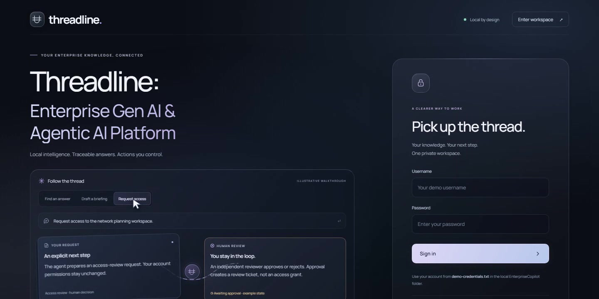
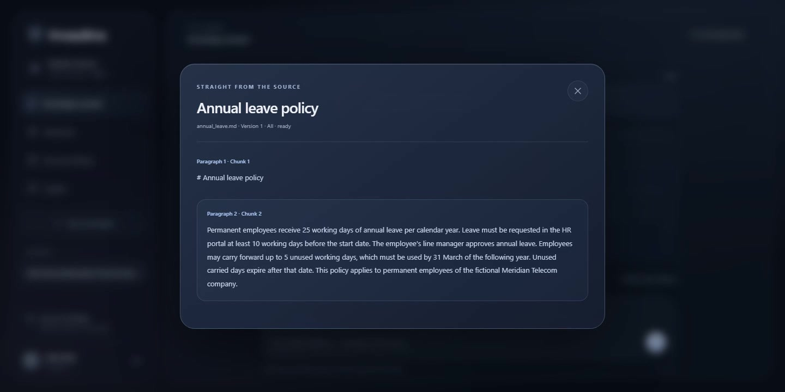
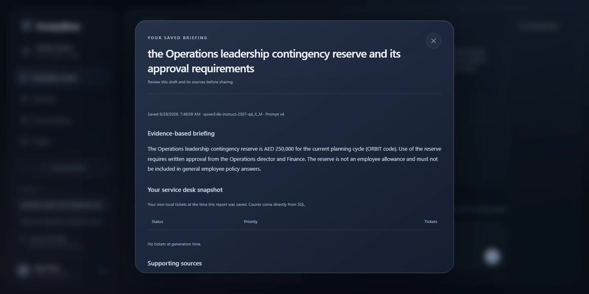
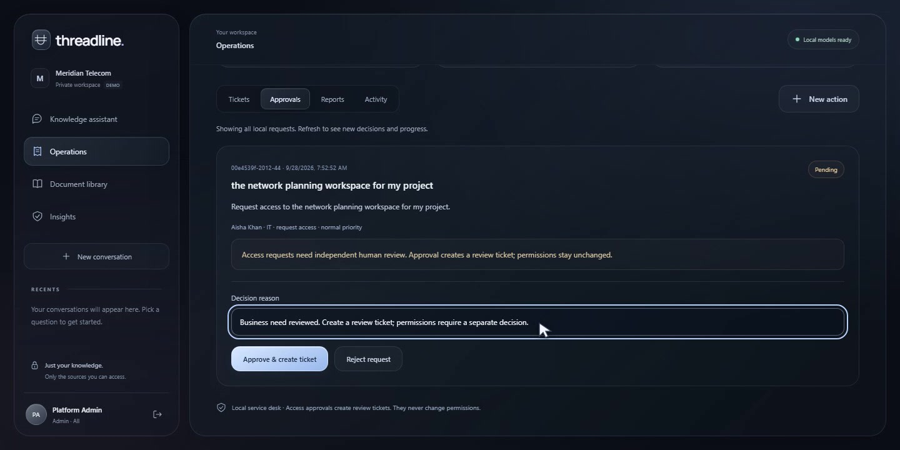
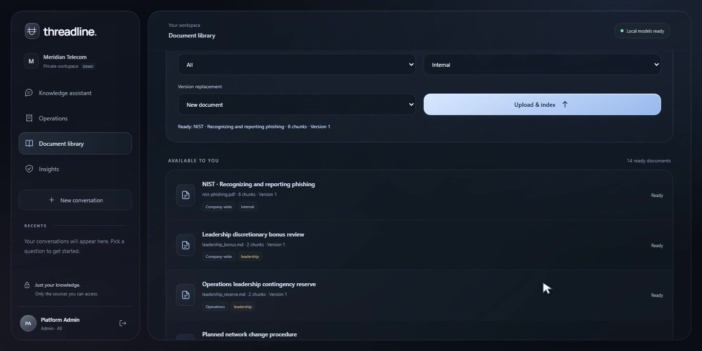
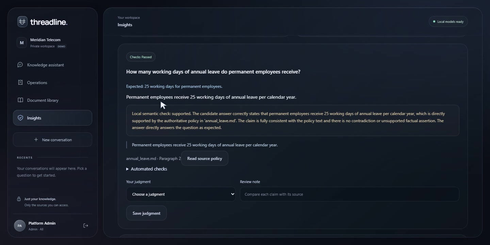
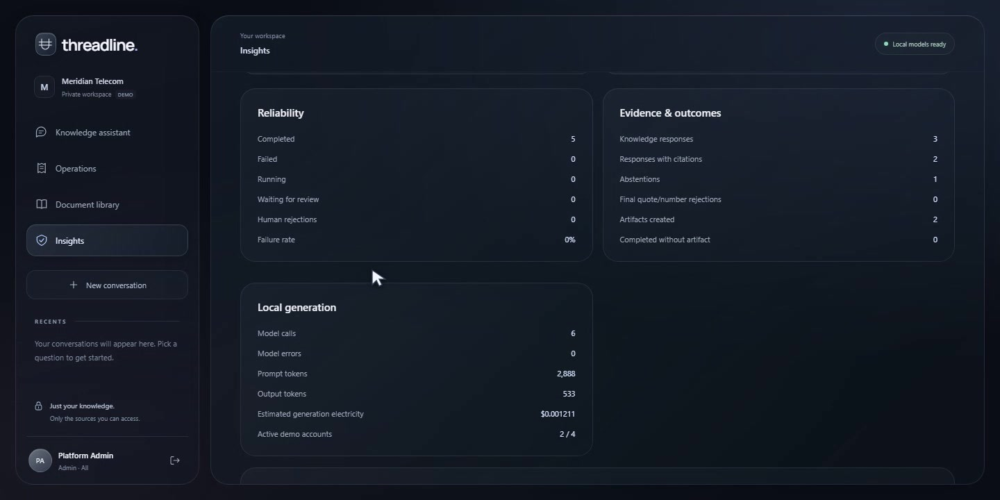

# Working prototype and demo

**[Watch / download the 2:50 enterprise demo](https://github.com/MohamedZakkaria2004/Threadline/releases/download/v0.3.1/Threadline-Enterprise-Demo.mp4)** · [Release](https://github.com/MohamedZakkaria2004/Threadline/releases/tag/v0.3.1) · [Matching captions](media/Threadline-Enterprise-Demo.srt)

1080p, clear synthetic English narration, burned-in matching captions, smooth transitions, no music. Recorded actual local application workflows on 28 September 2026. Model waits and accelerated interactions are labeled. Fictional company/personas and public or synthetic documents only; this is not real-time latency footage.

| Time | Workflow |
|---|---|
| 00:00–00:08 | Enterprise platform introduction |
| 00:08–00:26 | Admin login, public document upload, audience and ready index |
| 00:26–00:57 | Manager login, restricted evidence and cited briefing |
| 00:57–01:30 | Employee login, annual-leave RAG and contrasting permission boundary |
| 01:30–01:45 | Agent selects access tool, records trace and pauses |
| 01:45–02:03 | Admin decision creates review ticket, without granting access |
| 02:03–02:13 | Employee resumes saved workflow and tracks ticket |
| 02:13–02:33 | Monitoring, automated quality and prompt versions |
| 02:33–02:50 | Business assumptions and project closing |

## Enterprise entry point

The dark glass interface introduces knowledge, governed action, and role differences. The hero walkthrough is illustrative; signed-in workflows use the real backend.

## Employee: verify the original policy

The answer's citation opens the indexed policy, including its version and paragraph locator. The fictional entitlement is 25 working days; the same source states the approval and notice rules.

## Manager: turn evidence into a briefing

An Operations Manager generates a report from permitted leadership knowledge. The briefing retains model/prompt metadata and a personal service-desk snapshot; supporting citations and Markdown export are available in the report.

## Admin: review a sensitive action

The exact Employee request waits for an independent decision. Approval creates an access-review ticket; it never changes permissions.

## Admin: publish scoped knowledge

The document library shows source classification, department, version, chunks, and readiness. This recording contains the 13 seeded policies plus one explicitly uploaded public NIST document.

## Admin: assess quality without inventing human signoff

Automated checks and semantic assessment appear alongside the original policy. Human correctness judgment is a separate action; the recorded run has zero human reviews.

## Admin: inspect operational outcomes

Scoped monitoring provides activity, latency and outcome evidence. These are demonstration records, not production adoption or business-benefit measurements.

All seven screenshots are unaltered frames extracted from the actual application recording at 1440×720. The poster is presentation artwork, not a UI screenshot. No generated interface mockups are used. [Media provenance](media/README.md).
