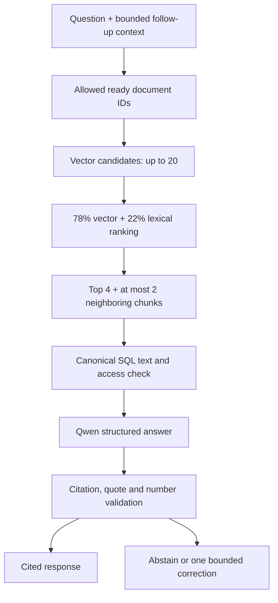

# Knowledge, RAG and agent workflows

The model proposes answers and structured plans. The application owns evidence, permissions, validation, and side effects.

## Enterprise document pipeline

1. **Admin chooses audience:** a supported department and `internal` or `leadership` classification. Upload authority is checked again before publication.
2. **Validate and parse:** PDF pages, DOCX body paragraphs/table text, and TXT/Markdown paragraphs retain location labels. Limits: 10 MB, 100 PDF pages, 200,000 extracted characters, 600 chunks.
3. **Chunk:** up to 160 words with 30-word overlap within extracted sections. Each chunk has an ID, document/version association, position, text, and locator.
4. **Embed locally:** nomic uses `search_document:` for chunks and `search_query:` for questions. Empty, inconsistent, or nonfinite vectors are rejected.
5. **Stage/index:** persistent Qdrant stores vectors; SQLite stores canonical text, hash, filename, version, audience, model and status.
6. **Publish:** only a completely indexed document becomes ready. Duplicate content is detected. Explicit replacement supersedes the old version only after success.

Scanned/encrypted PDFs and unsupported formats receive actionable errors; OCR is not implemented. DOCX headers, footers, embedded images and complex layout are outside scope. Public PDFs in the evaluation folder are validation fixtures; normal seeding loads the 13 fictional policies, not every PDF automatically.

Missing index points produce an explicit failure. Re-uploading identical content can repair the affected document through a new atomic version. Changing embedding model selects another collection and requires reindexing; do not mutate model contents behind an active tag.

## Retrieval and grounded answers



The vector similarity floor is 0.35, a heuristic rather than calibrated confidence. A bounded evidence-focus heuristic reduces unrelated policy mixing while retaining similarly matching competing rules. Four messages of limited history support follow-ups; history is context, not factual evidence. Topic changes retrieve independently unless reference markers indicate a follow-up.

### Citation contract

Each citation must refer to a retrieved source and include an exact normalized quotation. Its stored document ID/version and page or paragraph locator make the evidence inspectable. Source text is reloaded from SQL; a stale vector payload cannot redefine evidence or permissions. Fabricated IDs, unsupported quotes, and numerical claims absent from cited text are rejected. PDF normalization is bounded to known extraction artifacts, not free paraphrase.

A single correction may repair quote/numeric grounding, then the same checks run again. Relevant active policies with narrowly matching but conflicting numerical rules cause refusal. This is not a general semantic contradiction detector. An exact quote can still be misinterpreted; users and evaluators must compare the complete answer with its source.

Insufficient evidence, absent knowledge, and restricted-only evidence produce a cautious response without exposing restricted content. Permission changes during a slow request are checked at answer publication. Saved responses and report exports also reauthorize evidence against current access.

## Agent contract

**Knowledge mode is read-only. Actions mode requires explicit intent.** Input is bounded to 1,200 characters and one supported local action per request. Qwen returns a strict `ToolPlan`; its selection must match deterministic intent detection. Unsupported, ambiguous, or mismatched plans execute no tool.

| Tool | Example request | Result | Governance |
|---|---|---|---|
| `create_ticket` | “Create a support ticket for my monitor flickering during meetings.” | Real local support ticket | High/critical or sensitive requests require independent approval |
| `generate_report` | “Generate a report on annual leave entitlement, approval, and notice period.” | Saved cited briefing and Markdown download | Same scoped RAG; no evidence means no saved report; owner-only access |
| `request_access` | “Request access to the network planning workspace for my project.” | Pending review, then review ticket if approved | Always requires independent review; never changes permissions |

Ticket descriptions/priorities derive from the user's original request so generated plans cannot invent business facts. Reports include SQL counts of the owner's tickets at generation time, not aggregate department counts. Superseded report sources are marked historical; revoked or missing provenance blocks export.

## Approval and persisted state

```mermaid
sequenceDiagram
    actor E as Employee
    participant A as API and agent service
    participant Q as Local Qwen
    participant D as SQLite
    actor H as Eligible reviewer
    E->>A: Explicit access request + request ID
    A->>Q: Request structured tool plan
    Q-->>A: request_access
    A->>A: Validate intent, schema, risk, reviewer availability
    A->>D: Save exact plan, digest, pending approval and conversation
    A-->>E: Waiting for independent review
    H->>A: Review exact request, decision and reason
    A->>D: Transaction: reauthorize reviewer, recheck state and digest
    alt Approved
        A->>D: One access-review ticket + completed workflow/message + audit
    else Rejected
        A->>D: Rejected workflow/message + audit; no ticket
    end
    E->>A: Refresh operations or reopen saved conversation
    A-->>E: Persisted decision and current ticket state
```

The unique user/request key and workflow/artifact constraints prevent duplicate local writes. Repeating an identical decision is idempotent; a conflicting decision fails. Status updates include expected previous state to reject stale changes. Pending approvals survive restart. Interrupted running work becomes visibly failed; side effects are never automatically replayed.

## Failure behavior

| Condition | Expected response / state |
|---|---|
| Model unavailable or invalid structured output | Explicit failure; no invented success or remote fallback |
| Concurrent model work | Busy response; user retries later |
| Broken/missing vector points | Actionable index failure; no partial fabricated evidence |
| Invalid citation or unsupported numbers | Bounded correction or insufficient evidence |
| Unsupported tool such as email or shell | No execution; guidance about supported actions |
| No independent reviewer | Clear failure instead of unreachable pending approval |
| SQL/audit failure during business write | Transaction rolls back |
| Restart during model work | Failed workflow, preserved evidence and visible interruption |

This is a constrained agentic system with planning, tool execution, persistent state, and human handoffs. General autonomous task chaining and external connector execution are future work.
